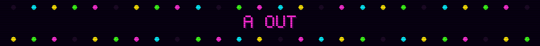
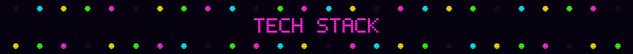
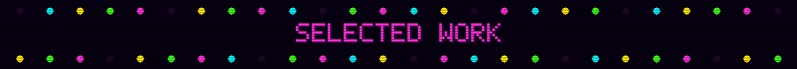
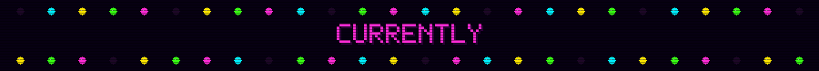
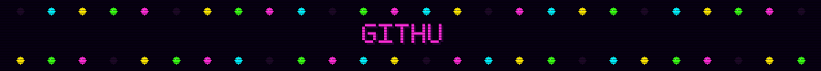
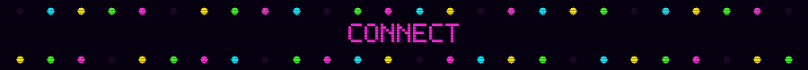

  

  

  
  
  
  
  

I'm **Nour Mamdouh**, a full-stack developer and Information Technology student at **Systemize**. I build software that holds up in production: SaaS products, business platforms, and data-driven dashboards.

I care about clean architecture, reliable APIs, and interfaces people can actually use.

| | |
| --- | --- |
| Focus | SaaS, enterprise apps, and business platforms |
| Stack | React, Next.js, TypeScript, .NET, Node.js, Python |
| Also | AI applications, analytics, cloud, and DevOps |
| Open to | Projects, collaborations, and new roles |

**Frontend**

**Backend**

**Data**

**Tools**

**AI and data**

**Forecast AI** — sales forecasting
Historical sales become forecasts a team can act on.
React, FastAPI, Python, scikit-learn, and data visualization.

**[Tgom CRM](https://github.com/nourmamdouhdev/TgomCrm)** — business platform
Modular CRM with authentication and a layered backend.
Angular, C# / .NET, Entity Framework Core, and JWT.

**[Trace Force MRV](https://github.com/nourmamdouhdev/Egytrace_Demo-)** — emissions analytics
Reporting, quality checks, and compliance for MRV data. The public build is Egytrace: Excel in, dashboards, validation, traceability, and automated reports out.
Next.js, React, and TypeScript.

**Opera** — tourism and booking
Booking flows and a customer-facing web experience.

Also on GitHub: [Elzbawyh POS](https://github.com/nourmamdouhdev/3zbawyh) · [Elearn](https://github.com/nourmamdouhdev/Elearn) · [Hospital system](https://github.com/nourmamdouhdev/-Hospital-UML-Depi-Group-2) · [Portfolio](https://nourmamdouh.vercel.app/)

- Building full-stack SaaS and enterprise applications
- Improving system architecture and backend design
- Bringing AI into software that already has a job to do
- Learning cloud, DevOps, and how applications scale

  

  
  

  

  

  <a href="https://nourmamdouh.vercel.app/">Portfolio</a>
  ·
  <a href="https://www.linkedin.com/in/nour-mamdouh/">LinkedIn</a>
  ·
  <a href="mailto:nourmamdouh54@gmail.com">nourmamdouh54@gmail.com</a>
  ·
  <a href="https://github.com/nourmamdouhdev">GitHub</a>

