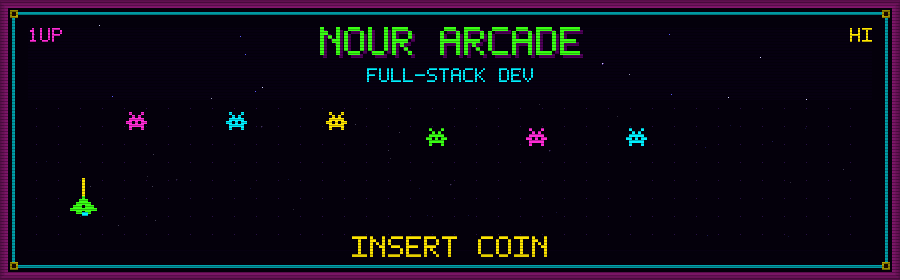

  

  

  
  
  
  
  

---

## Player 1

I'm **Nour Mamdouh**, a full-stack developer and Information Technology student at **Systemize**. I build software people can actually run in production: SaaS products, business platforms, and data-driven dashboards.

The cabinet looks like a game. The work behind it is the serious part — clean architecture, real users, and systems that hold up after launch.

| Stat | Loadout |
| --- | --- |
| Class | Full-stack developer |
| Main quest | SaaS, enterprise apps, and business platforms |
| Weapons | React, Next.js, TypeScript, .NET, Node.js, Python |
| Side quests | AI apps, analytics, cloud, and DevOps |
| Status | Open to projects, collaborations, and new runs |

---

## Power-ups

**Frontend**

**Backend**

**Data & services**

**Tools**

**AI & data**

---

## Select a cabinet

Click a cartridge. Each one is a real build.

 <b>01 · FORECAST AI</b> — sales forecasting

 

Enterprise-style sales forecasting. Historical sales go in. Actionable forecasts come out.

**Stack:** React, FastAPI, Python, scikit-learn, and data visualization.

 <b>02 · TGOM CRM</b> — business platform

 

A modular CRM with authentication and a layered backend.

**Stack:** Angular, C# / .NET, Entity Framework Core, JWT.

**Repo:** [TgomCrm](https://github.com/nourmamdouhdev/TgomCrm)

 <b>03 · TRACE FORCE MRV</b> — emissions analytics

 

Analytics for emissions reporting, MRV data, quality checks, and compliance. The public build is the Egytrace cement MRV platform: Excel in, dashboards, validation, traceability, and automated reports out.

**Stack:** Next.js, React, TypeScript.

**Repo:** [Egytrace Demo](https://github.com/nourmamdouhdev/Egytrace_Demo-)

 <b>04 · OPERA</b> — tourism & booking

 

A tourism and booking platform: booking flows and a customer-facing web experience.

More on the floor:
 [Elzbawyh POS](https://github.com/nourmamdouhdev/3zbawyh)
·
 [Elearn](https://github.com/nourmamdouhdev/Elearn)
·
 [Hospital system](https://github.com/nourmamdouhdev/-Hospital-UML-Depi-Group-2)
·
 [Portfolio](https://nourmamdouh.vercel.app/)

---

## Now playing

- Shipping full-stack SaaS and enterprise applications
- Tightening system architecture and backend design
- Plugging AI into software that already has a job to do
- Learning cloud, DevOps, and how apps scale

> Build software that solves real problems — not just software that works.

---

## Scoreboard

  
  

  

  

  <a href="https://nourmamdouh.vercel.app/">Portfolio</a>
  ·
  <a href="https://www.linkedin.com/in/nour-mamdouh/">LinkedIn</a>
  ·
  <a href="mailto:nourmamdouh54@gmail.com">nourmamdouh54@gmail.com</a>
  ·
  <a href="https://github.com/nourmamdouhdev">GitHub</a>

